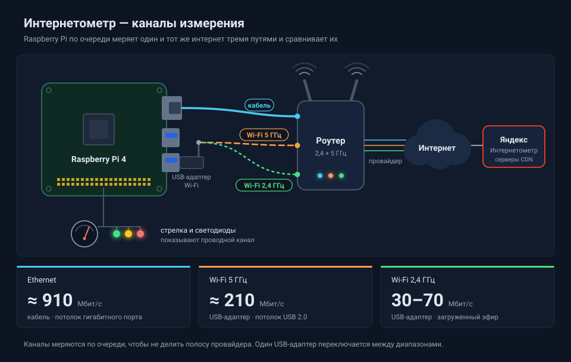
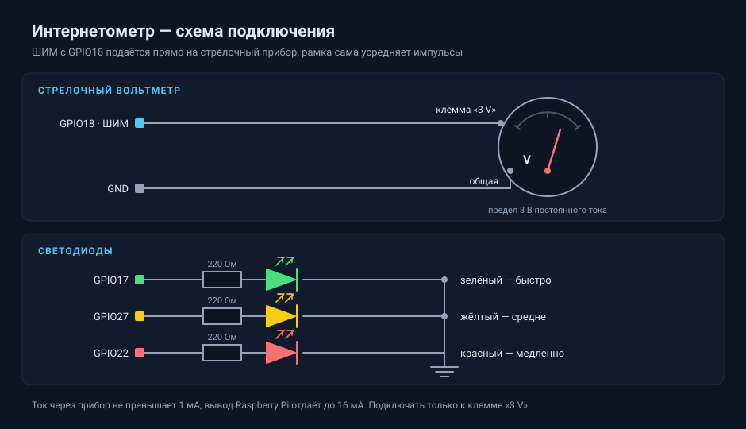

# Интернетометр

Замеряет скорость интернета по расписанию, пишет историю в SQLite и показывает
её в веб-дашборде. Умеет мерить несколько каналов по очереди — например, провод
и два диапазона Wi-Fi — и сравнивать их между собой.

Замеры делает [internetometer-cli](https://github.com/Master290/internetometer-cli),
клиент Яндекс Интернетометра.



Текущая скорость дополнительно выводится на стрелочный вольтметр: ШИМ с одного
пина GPIO даёт напряжение 0–3 В, пропорциональное мегабитам. Шкала печатается
генератором `scale-maker.html`. Без Raspberry Pi всё работает так же, стрелка
просто эмулируется.

## Требования

- Linux с NetworkManager (Raspberry Pi OS, Debian, Ubuntu)
- Python 3.9+, только стандартная библиотека
- `iw` — данные о Wi-Fi; `iputils-arping` — если каналов больше одного
- `python3-gpiozero` и `python3-lgpio` — если подключена стрелка

## Установка

```bash
cp config.example.json config.json
chmod +x install.sh
./install.sh
```

`install.sh` ставит Go, собирает клиент Яндекса, раскладывает файлы и включает
службу systemd.

Дальше поправьте `config.json` под своё железо — имена интерфейсов и профилей
NetworkManager у всех свои:

```bash
ip -br link
nmcli -g NAME,TYPE connection show
```

Если каналов больше одного, выдайте права и настройте ядро:

```bash
python3 internetometer.py --setup-routing > setup.sh
sudo bash setup.sh
```

Скрипт создаёт `/etc/sudoers.d/internetometer` (права на `ip`, `nmcli`,
`arping` без пароля) и `/etc/sysctl.d/99-internetometer.conf`. На одном
интерфейсе этот шаг не нужен — скрипт сам сообщит, что настраивать нечего.

## Каналы

Канал — это один измеряемый путь в интернет. Задаются в `interfaces`.

| Режим | Когда применять |
|---|---|
| `none` | один интерфейс, ничего переключать не надо |
| `route` | интерфейс поднят постоянно, на время замера получает маршрут по умолчанию |
| `switch` | несколько сетей на одном радиомодуле, переключение профилей NetworkManager |

Для `switch` укажите `connection` — имя профиля NetworkManager. Профиль не
должен быть привязан к интерфейсу, иначе он не поднимется на другом радио:

```bash
sudo nmcli connection modify 'ИМЯ-ПРОФИЛЯ' connection.interface-name ''
```

## Почему замер может показать чужую скорость

Главная опасность многоканальной схемы: маршрут выставлен на нужный интерфейс,
проверка проходит, а трафик идёт через другой — и его скорость записывается под
чужой меткой. Wi-Fi 2,4 ГГц «показывает» 900 Мбит/с, потому что на самом деле
меряется провод.

Защита работает на четырёх уровнях:

- **переключение проверяется по факту** — сверяется реально активный профиль, а
  не просто наличие адреса на интерфейсе;
- **маршрут удерживается всё время замера** — NetworkManager переписывает
  маршруты и посреди замера, поэтому маршрут переустанавливается каждые 2 с;
- **рассылается gratuitous ARP** — куда придёт ответ, решает ARP-таблица
  роутера, а не наши маршруты;
- **считаются байты на каждом интерфейсе** — если их принял не тот интерфейс,
  результат отбрасывается. Скорость дополнительно сверяется с `rx bitrate`
  из `iw`: замер не может быть быстрее физической скорости линка.

### Несколько интерфейсов в одной подсети

Если провод и Wi-Fi воткнуты в один роутер, Linux по умолчанию отвечает на
ARP-запрос про любой свой адрес с любого интерфейса. Роутер запоминает адрес
Wi-Fi за MAC-адресом провода и шлёт туда всю закачку. Лечится настройками
ядра из `--setup-routing`:

```
net.ipv4.conf.all.arp_ignore = 1
net.ipv4.conf.all.arp_announce = 2
net.ipv4.conf.all.rp_filter = 2
```

При старте программа предупреждает, если интерфейсы в одной подсети, а защита
выключена.

### Разброс между замерами

Клиент Яндекса каждый раз выбирает CDN-узел заново, и соседние замеры по одному
кабелю могут дать 800 и 240 Мбит/с. Судить по одному замеру нельзя — смотрите
на серию в дашборде.

## Стрелка и светодиоды



Стрелочный прибор подключается прямо к GPIO18, без фильтра: ШИМ на 1 кГц для
него слишком быстрый, и рамка сама усредняет импульсы. Если стрелка мелко
дрожит, поднимите `meter.pwm_frequency_hz`. Подключать только к пределу 3 В.

Светодиоды показывают зону скорости канала, который ведёт стрелку. Лишние можно
не ставить — пин в конфиге задаётся `null`. Если остаются только зелёный и
красный, сделайте `yellow_min_mbps` равным `green_min_mbps`, иначе средняя зона
окажется без индикации.

## Команды

```bash
python3 internetometer.py                  # служба: замеры по расписанию + дашборд
python3 internetometer.py --test-once      # один цикл по всем каналам, вывод в консоль
python3 internetometer.py --probe --iface usb5    # разбор ответа клиента по каналу
python3 internetometer.py --sweep          # прогон стрелки до упора и обратно
python3 internetometer.py --set-volts 1.5  # держать напряжение для калибровки
python3 internetometer.py --setup-routing  # сгенерировать скрипт настройки прав и ядра
```

Дашборд — `http://<адрес>:8080/`.

## Настройки

| Ключ | Что делает |
|---|---|
| `interval_minutes` | период замеров |
| `interfaces` | список каналов |
| `meter.gpio_pwm` | пин ШИМ для стрелки |
| `meter.full_scale_mbps` | скорость на конце шкалы |
| `meter.calibration_gain` | поправка, если стрелка не доходит до конца |
| `meter.source_interface` | какой канал ведёт стрелку |
| `leds.*_gpio` | пины светодиодов, `null` — выключены |
| `yandex.timeout_seconds` | таймаут клиента |

## Служба

```bash
sudo systemctl status internetometer
journalctl -u internetometer -f
```

При ручном запуске сначала остановите службу — она держит порт 8080 и пин GPIO.

## Благодарности

Замеры делает [internetometer-cli](https://github.com/Master290/internetometer-cli)
от Master290 (MIT). Это неофициальный клиент: если Яндекс изменит API
Интернетометра, замеры остановятся до обновления клиента.

## Лицензия

MIT.
